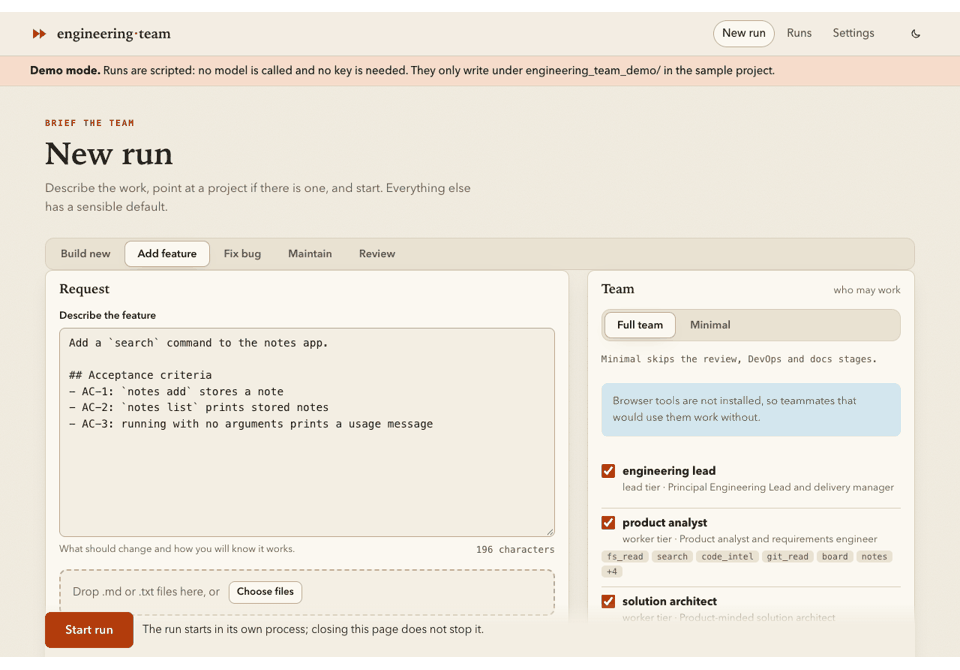
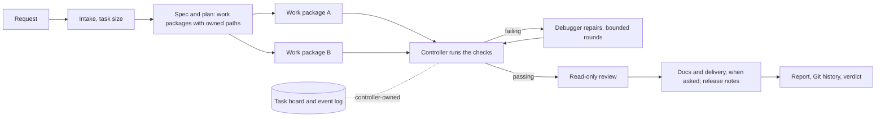

# Engineering Team

[](https://github.com/alexandre0sheva/crewai-engineering_team/actions/workflows/ci.yml)
[](LICENSE)


**A team of AI specialists that builds, changes and fixes software, and proves what it did:** a CrewAI
pipeline in which a controller, not the agents, runs the checks, moves the task board and decides what
counts as done.

**[Website](https://alexandre0sheva.github.io/crewai-engineering_team/)** ·
**[Leaderboard](https://alexandre0sheva.github.io/crewai-engineering_team/leaderboard/)** ·
**[Example run reports](https://alexandre0sheva.github.io/crewai-engineering_team/examples/)** ·
[Docs](docs/USAGE.md)


*`do` on a bug (a live run on the `openai` preset, recorded from a [`vhs` tape](docs/assets/demo.tape): 148 s,
about $0.003). See [Try it without a key](#try-it-without-a-key).*



*The web UI on a scripted run (`ui --demo`: the real pipeline and board, no model, no key).*

## What it does

Say what you want: `engineering-team do "Add a /search endpoint"`. The team works out what kind of work it
is, shows the plan, the stages and an estimated cost, asks before it starts, and then builds, changes, fixes
or reviews, on a branch, never in your checkout blindly. Each kind of work is also a command of its own:

| Mode | Command | Result |
|------|---------|--------|
| **new** | `engineering-team new` | A project from a request, in a Git repository of its own: spec, architecture, code, tests, docs |
| **feature** | `engineering-team feature` | A feature in an existing project, on a branch, checked against the project's own tests before and after |
| **fix** | `engineering-team fix` | A bug reproduced first (red), fixed, and shown fixed (green) |
| **maintain** | `engineering-team maintain` | Tests added, a refactor, dependency upgrades, docs, or a security audit |
| **review** | `engineering-team review` | A read-only review of a branch or diff, with `findings.json` for CI |
| **analyze** | `engineering-team analyze` | What an existing project is made of, and (with `--deep`) a codebase map |

Every run records a manifest, an event log, the task board and a self-contained HTML report you can open
or attach to a pull request. The team is stack-agnostic: it uses the runtimes you have installed.

## Install

You need Python 3.11–3.13, [uv](https://docs.astral.sh/uv/) and an API key for a model provider (OpenAI by
default; Anthropic, Google, Ollama and Azure are presets).

```bash
uv tool install --python 3.13 engineering_team
# or: pipx install --python python3.13 engineering_team
```

Pin the interpreter (3.11, 3.12 or 3.13): without `--python`, `uv tool install` can pick a newer Python
that CrewAI does not support yet, and the tool then fails on start. For the development version, install from
Git instead: `uv tool install --python 3.13 git+https://github.com/alexandre0sheva/crewai-engineering_team`.
To work on the project itself, see [CONTRIBUTING.md](CONTRIBUTING.md).

## Quickstart

```bash
export OPENAI_API_KEY=...                          # or put it in a .env file
engineering-team doctor                            # is this machine ready?
engineering-team do --example tiny-notes           # a cheap bundled example (the smoke profile)
engineering-team do --request-file my-idea.md --project-name my-idea
engineering-team do "Fix the crash when the note list is empty" --repo ../my-service   # an existing project
engineering-team do "Add dark mode" --dry-run      # only the plan: what it is, the stages, the cost
```

`do` shows what it understood and what it will do, and asks before it starts (`--yes` skips the question).
`new`, `feature`, `fix`, `maintain`, `review` and `analyze` are the same thing with the kind of work fixed.
In a terminal you get a live view: progress, the task board as a kanban, parallel lanes and cost against
your budget. The project appears in `./workspace/my-idea/`. Steer a run from another terminal with
`board --watch`, `note`, `pause` and `cancel`; continue an interrupted one with `resume`.

Prefer a browser?

```bash
uv tool install --python 3.13 "engineering_team[ui]"
engineering-team ui                                # http://127.0.0.1:8765/
```

Start runs, watch them live (task board, teammates, activity, timeline, replay), steer them and review
the diff, the criteria coverage and the report. Commands, exit codes and how to write a request the team
can succeed with are in [docs/USAGE.md](docs/USAGE.md).

### Try it without a key

`engineering-team ui --demo` runs the real pipeline, board, checks and report with a **script instead of a
model**: every state of the dashboard shows up and nothing is billed. The [`examples/`](examples/) have
three scenarios (a new project, a feature on a legacy service, a bug fix) with their requests, the
outcome to expect, and committed run reports each: a scripted one (the same way, so it shows what a report
looks like, not what a model writes) and a live one, labelled with its model, cost and date.

## The team

Thirteen teammates, each with its own prompt, model tier and tool groups, all changeable in configuration
or YAML ([docs/TEAM.md](docs/TEAM.md)):

| Role | Teammates |
|------|-----------|
| Plan | `product_analyst` (specification), `solution_architect` (design and work split) |
| Build | `backend_engineer`, `frontend_engineer`, `quality_engineer` (tests), `devops_engineer`, `technical_writer`, `generalist_engineer` |
| Check | `code_reviewer`, `security_engineer` (read-only reviewers), `debugger` (reproduces failures and repairs) |
| Understand | `codebase_analyst` (explains an existing project) |

Add your own teammate, tool, MCP server or hook without changing the code
([docs/CONFIGURATION.md](docs/CONFIGURATION.md)).

## How it works



- **The controller decides.** Agents report; the controller runs the tests, linters and the project's own
  commands itself, writes `docs/verification.md` from what it saw, and is the only thing that moves a card to
  done. An agent's claim that it finished is a request for verification, not evidence.
- **Parallel without merging.** Work packages run side by side, each agent allowed to write only the paths
  its package owns, so there is nothing for a model to merge.
- **Resumable and bounded.** Stages are recorded, so a cancelled or failed run continues without redoing
  finished work, and budgets (cost, tokens, time, tool calls) stop a run that overspends.
- **Safe by default, sandbox on request.** Agents work inside the project, commands run without a shell from
  an allowlist with a scrubbed environment, the web and MCP are off until you enable them, and
  `--sandbox docker` runs every command in a hardened container.

Design, module map, run state and the alternatives that were rejected: [docs/ARCHITECTURE.md](docs/ARCHITECTURE.md).
The execution boundary and threat model: [docs/SAFETY.md](docs/SAFETY.md).

## Tools

Agents get a catalogue of structured tools rather than a shell: reading and searching, atomic multi-file
patches, test/lint/type-check/build runners that return parsed results, code intelligence (symbols,
references, importers, hotspots), read-only Git, background processes with an HTTP client, a headless
browser for UI checks, and, only when enabled, web search and fetching. Every tool, its group and its limits
are in [docs/TOOLS.md](docs/TOOLS.md).

## Measured, not assumed

A benchmark suite of greenfield and brownfield tasks, judged by hidden behavioural checks the team never
sees, shapes the defaults: on small tasks one agent matched the staged `pipeline` at a fraction of the cost
(and beat it on the dev tasks, 24/25 against 7/12), so a run starts on the cheapest rung and escalates only
when the controller's checks fail. Pass rates come with confidence intervals and cost per success.

The 0.3.0 evaluation ran the team on four provider presets next to Claude Code, Codex and OpenCode on the
same tasks and hidden checks (held-out split, eight tasks, two repeats):

| Contender | Passed | Pass rate (95 % interval) | Cost / success | Median time |
|-----------|--------|---------------------------|----------------|-------------|
| Team (`auto`), preset `openai` | 11/16 | 69 % (44–86 %) | $0.027 | 102 s |
| Team (`auto`), preset `anthropic` | 14/16 | 88 % (64–97 %) | $0.10 | 2.3 min |
| Team (`auto`), preset `openrouter` | 12/15 | 80 % (55–93 %) | $0.11 | 8.9 min |
| Claude Code (plan, its own model) | 14/16 | 88 % (64–97 %) | plan, about $0.11 a run | 34 s |
| Codex (plan, its own model) | 13/16 | 81 % (57–93 %) | plan | 94 s |
| OpenCode (same model as the `openrouter` worker) | 14/16 | 88 % (64–97 %) | $0.030 | 2.2 min |

**What it shows, honestly:** the team is **not distinguishable** from the external agents on pass rate at this
sample size (every interval overlaps; the paired sign tests are all above 0.05), and it is **not shown to be
better**. Its successes on the cheapest preset cost a quarter of a Claude Code run, but on a different model;
against OpenCode on the *same* model the team was about four times dearer per success and four times slower.
One of the eight tasks was failed by every contender. Three held-out tasks had checks stricter than their
requests; they were amended after the first results were seen and rerun, so on them the benchmark is not blind
(the first pass and the amendment are both committed and explained in
[docs/BENCHMARKS.md](docs/BENCHMARKS.md#the-amendment-of-2026-11-17)). What the checks cannot see (budget caps,
the verification report, review, resumability) is not measured. Costs for the plan-billed agents are not API
money; Aider was not available.

The leaderboard lists each batch as it ran. The rows below are single batches (the six easier held-out tasks,
ten runs, no external agents), so they read higher than the pooled table above: compare contenders only in that table.

<!-- leaderboard:start (generated by scripts/build_leaderboard.py) -->
| Contender | Model | Split | Pass rate (95 % interval) | Cost / success | Runs | Date |
|-----------|-------|-------|---------------------------|----------------|------|------|
| `auto` | openai/gpt-6-luna, openrouter/deepseek/deepseek-v4.1-flash | held-out | 80% (49%–94%) | $0.0074 | 10 | [2026-11-16](https://github.com/alexandre0sheva/crewai-engineering_team/tree/main/benchmarks/results/2026-11-16/value-auto-heldout) |
| `auto` | anthropic/claude-haiku-5-5, anthropic/claude-sonnet-5-5 | held-out | 80% (49%–94%) | $0.0393 | 10 | [2026-11-16](https://github.com/alexandre0sheva/crewai-engineering_team/tree/main/benchmarks/results/2026-11-16/anthropic-auto-heldout-a) |
| `auto` | openrouter/deepseek/deepseek-v4.1-flash, openrouter/minimax/minimax-m3.1-flash | held-out | 80% (49%–94%) | $0.0500 | 10 | [2026-11-16](https://github.com/alexandre0sheva/crewai-engineering_team/tree/main/benchmarks/results/2026-11-16/openrouter-auto-heldout-a) |

Top rows of the [leaderboard](https://alexandre0sheva.github.io/crewai-engineering_team/leaderboard/), which lists every batch.
<!-- leaderboard:end -->

Method, threat model and every number: [docs/BENCHMARKS.md](docs/BENCHMARKS.md#results-2026-11-16-the-030-evaluation) and
[`benchmarks/results/`](benchmarks/results/2026-11-16/). `engineering-team bench run --fake` checks the
harness offline.

## Limitations

- **Small samples.** The 0.3.0 evaluation is eight held-out tasks with two repeats per contender, one machine,
  one day. Its intervals are wide (about ±20 points), it cannot separate the team from Claude Code, Codex or
  OpenCode on pass rate, and it does not score code quality, docs or review. [Read the caveats](docs/BENCHMARKS.md#limits-of-this-evaluation) before quoting a number.
- **Models are not deterministic**, and a live run costs real money. Set `budget.max_cost_usd` and use the
  `smoke` profile while you learn what a run costs ([docs/CONFIGURATION.md](docs/CONFIGURATION.md#budgets)).
- **The local backend is a project boundary, not a sandbox.** Use `--sandbox docker`, or a container or VM,
  for untrusted requests or dependencies. Plugins, MCP `command` servers and hooks run outside it by design.
- **Acceptance criteria are verified only when you say how**: without a checks file the report lists them
  as unverified and marks a test suite that merely mentions one as referenced.
- **Python 3.11–3.13.** CrewAI 1.15 itself declares `<3.14`.
- **0.2.0 is alpha.** Interfaces may still change before 1.0.

## Contributing and license

Issues and pull requests are welcome: [CONTRIBUTING.md](CONTRIBUTING.md) has the gate (the tests run offline,
no key needed), the testing helpers and the release process. Report vulnerabilities privately
([SECURITY.md](SECURITY.md)). Be kind: [Code of Conduct](CODE_OF_CONDUCT.md). Changes by version:
[CHANGELOG.md](CHANGELOG.md). MIT licensed ([LICENSE](LICENSE)).

Built on [CrewAI](https://docs.crewai.com/); coding assistants working on this repository should read
[AGENTS.md](AGENTS.md) first.
