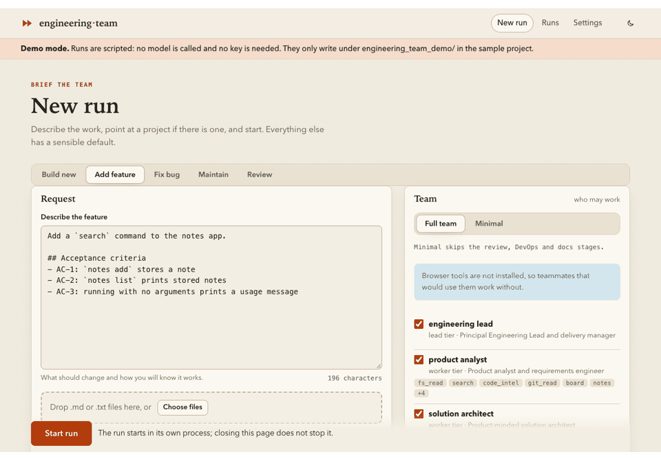

# Engineering Team

**A team of AI specialists that builds, changes and fixes software, and proves what it did.** A CrewAI
pipeline in which a controller, not the agents, runs the checks, moves the task board and decides what
counts as done.



*The web UI on a scripted run (`ui --demo`: the real pipeline and board, no model, no key). A terminal
recording of `do` on a bug is [recorded from a tape](https://github.com/alexandre0sheva/crewai-engineering_team/blob/main/docs/assets/demo.tape)
(`vhs docs/assets/demo.tape`).*

## Say what you want

```bash
engineering-team do "Fix the crash when the note list is empty" --repo ../my-service
```

The team works out what kind of work it is (a new project, a feature, a fix, a review), shows the plan, the
stages and an estimated cost, asks before it starts, and then works on a branch, never blindly in your
checkout. [Usage](USAGE.md) has every command and how to write a request the team can succeed with.

## How it proves done

- **The controller decides, not the agents.** An agent saying it finished is a request for verification,
  not evidence. The controller runs the tests, linters and the project's own commands itself and writes
  the verification record from what it saw.
- **A fix is red, then green.** The team first reproduces a bug with a test that fails because of it; only
  then does it fix the code, and the same reproduction must pass.
- **Hidden checks measure it.** On the benchmark suite the work is judged by behavioural checks the team
  never sees; pass rates come with confidence intervals and cost per success, and the
  [leaderboard](leaderboard.md) lists every committed batch, the weak and the small ones too.
- **Bounded and resumable.** Budgets stop a run that overspends, every stage is recorded so an
  interrupted run continues where it stopped, and `--sandbox docker` runs every command in a hardened
  container ([Safety](SAFETY.md)).

Design and data flow: [Architecture](ARCHITECTURE.md). The teammates: [Team](TEAM.md). What agents can
call: [Tools](TOOLS.md).

## Install

You need Python 3.11–3.13, [uv](https://docs.astral.sh/uv/) and an API key for a model provider (OpenAI by
default; Anthropic, Google, Ollama and Azure are presets).

```bash
uv tool install --python 3.13 git+https://github.com/alexandre0sheva/crewai-engineering_team
engineering-team doctor                       # is this machine ready?
engineering-team do --example tiny-notes      # a cheap bundled example
```

No key yet? `engineering-team ui --demo` runs the real pipeline with a script instead of a model
([Usage](USAGE.md#demo-mode)).

## Three example requests

Each is a small, runnable scenario with the request the team gets and a self-contained run report: the
board, the checks, the cost and the diff. The [examples page](examples.md) says which reports came from a
live model and which were scripted.

| Request | Mode | Reports |
|---------|------|---------|
| A command-line notes tool from nothing | `new` | [live](reports/greenfield-notes-live.html) · [scripted](reports/greenfield-notes.html) |
| A low-stock report endpoint for a legacy inventory service | `feature` | [live](reports/feature-on-legacy-live.html) · [scripted](reports/feature-on-legacy.html) |
| The crash of `shop report` on an empty cart | `fix` | [live](reports/bugfix-live.html) · [scripted](reports/bugfix.html) |
